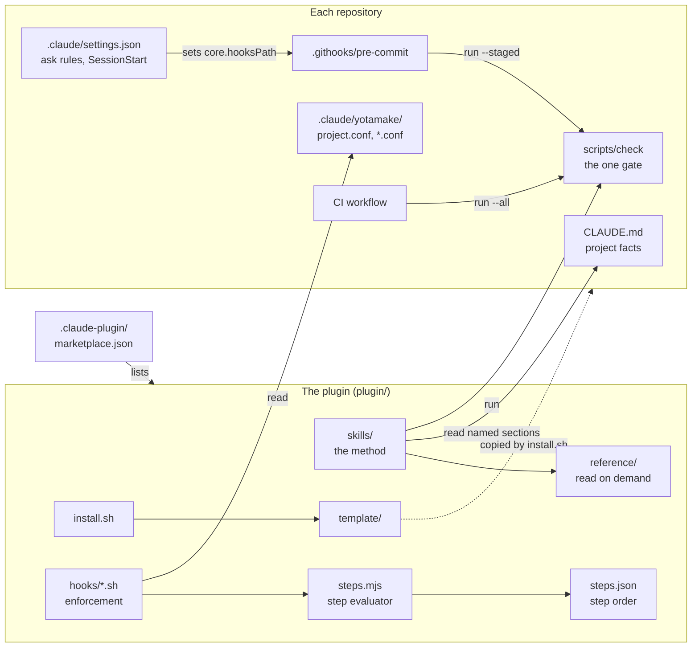

# Yotamake

A development harness for Claude Code. It gives any repository the same working method:
small sessions on branches, design and reuse checked before code, one check command that
everyone runs, nothing committed or deployed without a "yes", and a docs system that stays
true.

It started as the `.claude/` setup and docs rules of a single application project.

The website, [redazzo.github.io/Yotamake](https://redazzo.github.io/Yotamake/), introduces
the harness and walks through getting started. This README is the overview; each skill's
`SKILL.md` and the docs in [`docs/`](./docs/README.md) hold the detail.

## Install

**1. Add the plugin** (once per machine), in Claude Code:

```
/plugin install yotamake --marketplace redazzo/Yotamake
```

or from a shell: `claude plugin marketplace add redazzo/Yotamake`, then
`claude plugin install yotamake@yotamake`.

**2. Set up each repository.** In Claude Code, inside the repo, run `/yotamake:setup`. It runs
the plugin's `install.sh` and then helps fill in the project facts from the repo itself. Or
run it by hand from a clone of this repo:

```bash
./plugin/install.sh /path/to/your/repo
```

If the repo has no `README.md`, a full install writes a stub, because `CLAUDE.md` links to
it and the docs check would fail without it.

The repo's `.claude/settings.json` then names this marketplace and enables the plugin, so
teammates who open the repo in Claude Code are prompted to install it.

The installer points git at `.githooks/` (`core.hooksPath`). It leaves that setting alone when
the repo already uses another hook tool (a `.pre-commit-config.yaml`, a lefthook config, or a
hook in `.git/hooks/`), because git would stop running that tool's hooks. It then prints the
lines that call `.githooks/pre-commit` from the other tool. The same tests run at the start of
every Claude Code session, from a `SessionStart` hook in the repo's `.claude/settings.json`
(ADR-0004), so a fresh clone gets the setting too.

If the repo already has its own version of a template file, such as a docs linter, list the
harness path in `.claude/yotamake/skip` (one per line). The installer never writes a listed
path, and adds no `allow` rule or hook entry for a listed script the repo does not have.
To turn off the `SessionStart` hook that sets `core.hooksPath`, list
`.claude/yotamake/set-hooks-path.sh` there and delete the file. The same goes for
`.claude/yotamake/session-context.sh`, the second `SessionStart` hook: at the start of each
session it adds a few lines to Claude's context (the branch and whether it is the main
branch, any active multi-session effort and its next session, and the rule that every change
runs as a session), so the method holds even when a skill does not fire.

**Lite mode.** For a small repo that does not want the docs system (ADRs, records, backlog),
run `install.sh <repo> --lite`, or ask `/yotamake:setup` for lite mode. It installs
`CLAUDE.md`, `scripts/check`, the pre-commit hook, the hook config and settings, but nothing
under `docs/` or `scripts/docs/`. It writes those paths into `.claude/yotamake/skip`, so later
runs leave them out too, and drops the docs lines from the new `CLAUDE.md` and
`scripts/check`. To add the docs system later, delete those lines from the skip file, re-run
the installer, and add the docs check to `scripts/check` by hand.

**Updating.** `claude plugin update yotamake@yotamake` updates the method for every repo at
once. Re-run `/yotamake:setup` (or `install.sh`) in a repo to refresh its harness-owned
scripts; it never overwrites the files that belong to the project. It also regenerates
`docs/records/README.md` when it is stale. That file is generated, not written by hand, and
a refreshed generator could otherwise leave the docs check failing.

When a new version needs something added to those files, such as a new line in `CLAUDE.md`,
`plugin/reference/upgrades.md` says what and how to check for it. The installer records the
version it ran in `.claude/yotamake/version`. When a session starts in a repo older than the
plugin, the plugin's `SessionStart` hook tells Claude so in one line, and Claude offers the
upgrades still missing (`simple-session`, "Harness upgrades").
`/yotamake:setup` applies them on a refresh.

## How it is split

| Lives in | What | Who changes it |
|---|---|---|
| The plugin (`plugin/`) | Skills, hooks, output style, the installer and template | This repo; reaches every project on update |
| Each repository | `CLAUDE.md` facts, `scripts/check`, `docs/`, hook config, CI workflow | The project |
| Each repository, harness-owned | `scripts/docs/*.mjs`, `.githooks/pre-commit`, `.claude/yotamake/set-hooks-path.sh`, `.claude/yotamake/session-context.sh`, `.claude/yotamake/version` | Refreshed by the installer |

How the parts connect. Solid arrows are what runs or reads what; the dotted arrow is the
one-time copy the installer makes.



### The plugin

<!-- inventory: plugin/skills/*/ plugin/hooks/* plugin/reference/*.md -->
```
plugin/
  .claude-plugin/plugin.json
  skills/
    simple-session/   one change: size check, branch, work, docs, scripts/check, stop and ask
    multi-session/    work too big for one session, with a working folder that survives /clear
    debugging/        a bug fix inside a session: reproduce, failing test, root cause, fix
    write-doc/        pick the doc kind, write it from its template, link it, lint it
    spec/             agree scope and acceptance criteria before code  (manual: /yotamake:spec)
    improve-architecture/  review the code's design, read-only (manual: /yotamake:improve-architecture)
    release-check/    guided deploy with pre-flight and gotchas      (manual: /yotamake:release-check)
    new-migration/    scaffold a timestamped migration file         (manual: /yotamake:new-migration)
    setup/            install or refresh the per-repo files         (manual: /yotamake:setup)
    doctor/           check the harness works in this repo, read-only (manual: /yotamake:doctor)
    drawio/           draw.io diagrams
  hooks/
    hooks.json                     registers the eight hooks below
    pre-edit-protect.sh            blocks edits to protected files (.env, keys, certificates), and reads of them
    pre-edit-main-branch.sh        blocks edits while the repository is on its main branch
    pre-bash-git.sh                blocks --no-verify, git commit on the main branch, and a commit before the check and review
    post-edit-check.sh             runs a fast per-file check after each edit
    post-edit-mark.sh              logs each edit (code or doc) for the step evaluator
    record-event.sh                logs review skill calls and user prompts for the step evaluator
    stop-check-ran.sh              blocks the end of a turn once when scripts/check has not passed since
    session-upgrades.sh            at session start, tells Claude when the repo's harness is older than the plugin
    lib.sh                         shared by the hooks: reads the hook input and project.conf, finds the gate files
    steps.json                     the steps each gated action needs, in order (ADR-0010)
    steps.mjs                      the step evaluator: logs events, decides from steps.json, classifies docs
  output-styles/plain-english.md   short sentences, plain words (pick it with /output-style)
  reference/architecture-styles.md styles with the boundaries, patterns and gates each implies
  reference/module-design.md       deep and shallow modules, seams, the deletion test
  reference/domain-language.md     the glossary: its rules, its format, naming drift
  reference/upgrades.md            per version: what to add to a repo's own files, and how
  reference/autopilot.md           multi-session autopilot: sessions run in agents on one branch
  reference/parallel-sessions.md   multi-session: two sessions at once in sibling worktrees
  reference/harness-upgrades.md    simple-session: offer the upgrades an older harness is missing
  reference/findings-not-acted-on.md  simple-session: where a finding the branch leaves goes
  reference/integrate.md           simple-session: commit, bump, merge or open a pull request
  reference/missing-setup.md       simple-session: no gate, no Architecture, or a review tool missing
  install.sh                       installs template/ into a repo
  template/                        the per-repo files
  evals/                           the eval suite (see below)
```
<!-- /inventory -->

### Each repository

<!-- inventory: plugin/template/*.md plugin/template/.claude/* plugin/template/.claude/yotamake/* plugin/template/.githooks/* plugin/template/.github/workflows/* plugin/template/scripts/* -->
```
CLAUDE.md                       facts the skills read, by section name
scripts/check                   the one gate: skills, the pre-commit hook and CI all run it
.githooks/pre-commit            runs scripts/check --staged (fast checks only)
.github/workflows/check.yml     runs scripts/check --all
.claude/settings.json           enables the plugin; "ask" rules for commit, merge, push, …;
                                SessionStart hooks that run the two scripts below
.claude/yotamake/
  set-hooks-path.sh             sets core.hooksPath to .githooks in a clone that lacks it
  session-context.sh            tells Claude the branch, active efforts and the session rule
  protected-paths.conf          files Claude may not read or edit
  post-edit-checks.conf         glob → per-file check command
  project.conf                  the main branch and doc paths, for hooks (copied from CLAUDE.md)
  skip                          optional: template paths the installer must never write
  version                       the plugin version the harness files were installed from
docs/                           README (rulebook and index), backlog, decisions, records, …
scripts/docs/                   docs linter and records index generator
```
<!-- /inventory -->

## How it holds

Three ideas keep the method in place, and hooks back them up.

**Skills hold the method. `CLAUDE.md` holds the facts.** Skills read named sections
(Checks, Branching and releases, Migrations, Deploying, Conventions, Architecture). If one is
missing or unfilled, the skill says so and uses a stated default, or stops and asks. It never
guesses a deploy or migration command. Hooks read the two facts they need, the main branch
and the doc paths, from a copy in `.claude/yotamake/project.conf`, which `/yotamake:doctor`
checks against `CLAUDE.md`.

**Design comes before code.** The `Architecture` section of `CLAUDE.md` has seven lines the
skills read: **Style**, **Modules**, **Boundaries**, **Shared code**, **Patterns**,
**Constraints** and **Domain language**, plus the accepted ADRs in a full install.
`/yotamake:setup` proposes them from the repo, naming the style from
`plugin/reference/architecture-styles.md`. Before any edit, `simple-session` looks for code
to reuse, and stops and asks when a change would break the design, even when told not to ask
(`simple-session`, "Design and reuse"). `scripts/check` has commented examples for a
boundary check and a duplicate-code check; the project picks the tool.

**One gate, run by everyone.** `scripts/check` is the only list of checks. Claude runs it
before proposing a commit. The pre-commit hook runs its fast checks on staged changes; slow
ones (usually tests) sit behind `full` in the script and wait for Claude's run and CI. CI runs
all of it. A person's commit passes the same gate as Claude's, once the clone has
`core.hooksPath` set ([hooks.md](./docs/reference/hooks.md#the-pre-commit-hook-in-a-clone)).

**Hooks.** Each guard in a line. How each one decides is in
[docs/reference/hooks.md](./docs/reference/hooks.md); each rule in `CLAUDE.md` and what
enforces it is in [rules-and-enforcers.md](./docs/reference/rules-and-enforcers.md).

| Guard | What it does |
|---|---|
| [Stop gate](./docs/reference/hooks.md#the-stop-gate) | Blocks the end of a turn once when code changed since `scripts/check` last passed |
| [Commit gate](./docs/reference/hooks.md#the-commit-gate) | Refuses `git commit` until the check has passed and `/simplify` and `/code-review` have run; a docs-only branch needs only the check |
| [Stop points](./docs/reference/hooks.md#stop-points-the-ask-rules) | `ask` rules make Claude Code ask before `git commit`, `merge`, `push`, `rebase`, `reset --hard` and `tag` |
| [Main branch](./docs/reference/hooks.md#no-edits-on-the-main-branch) | Refuses Edit and Write while the repository is on its main branch |
| [Secrets](./docs/reference/hooks.md#no-reading-secrets) | Refuses edits and reads of protected files, such as `.env` and keys |
| [Skipped hooks](./docs/reference/hooks.md#no-skipped-hooks-no-commits-on-main) | Refuses `--no-verify`, and `git commit` on the main branch |
| [Event log](./docs/reference/hooks.md#the-check-stamp-and-the-event-log) | Records edits, reviews and prompts, and when the check passed, for the two gates |
| [Worktrees](./docs/reference/hooks.md#worktrees) | Every hook acts on the repository of the file being edited (ADR-0005) |

A shell command gets past the edit hooks, and the gates see that a review ran, not that its
findings were fixed ([known gaps](./docs/reference/hooks.md#known-gaps-and-concerns)).

## Sessions

This section is an overview. Each skill's `SKILL.md` holds its rules and is the one to change.

A session is one change: one branch, one merge, one diff you can review and revert alone,
with its decisions settled first
([`simple-session`](./plugin/skills/simple-session/SKILL.md);
[ADR-0011](./docs/decisions/0011-session-sized-by-review-revert-and-decisions.md)). It checks
the size first, against the `Session size` line in `CLAUDE.md` (`simple-session`, "Check the
size"). With `Test-first: yes` in `CLAUDE.md` it writes a failing test before a change in
behaviour. A bug fix follows [`debugging`](./plugin/skills/debugging/SKILL.md): reproduce
it, write a failing test, find and name the root cause, then fix it. A change too big for
one session becomes a [`multi-session`](./plugin/skills/multi-session/SKILL.md) effort, with
a working folder that survives `/clear`: git-ignored at `.scratchpad/<date>-<slug>/`, or committed at
`.sessions/<date>-<slug>/` in an ephemeral environment or on an assigned branch. Its sessions
are numbered: S0 analyses the work and writes the plan, and the work starts at S1. You
`/clear` between sessions and resume with:
"Read .scratchpad/<folder>/README.md and start the next session."

**Specs.** For a new feature, or a change where "done" is unclear, run `/yotamake:spec`
first ([`spec`](./plugin/skills/spec/SKILL.md)). It agrees the scope and numbered acceptance
criteria in one short file before any code. Each criterion names a check that fails until it
is met, and an ordered task list is optional. Then it hands over to a session. Fixes, renames
and refactors skip it.

**Architecture review.** The checks above ask whether a change fits the design. To ask
whether the design itself is good, run `/yotamake:improve-architecture`
([`improve-architecture`](./plugin/skills/improve-architecture/SKILL.md)). It reads, starting
where git history shows the code changes most, and reports shallow modules worth deepening
and places where the code and the Architecture section disagree. It names the one to do
first, then hands what you choose to a session, the backlog or an ADR. It edits nothing.

**Review.** Once per session, after the checks pass, `simple-session` reviews the whole
branch diff with the built-in `/simplify` and `/code-review`, and against Architecture.
Trivial branches skip it (every changed line a comment or a prose typo). Docs-only branches
get a fit read instead, which moves detail that has outgrown a doc to its owner. The
`Docs-only` line in `CLAUDE.md` says which files are docs; the top of `simple-session` has
the default, says what counts as trivial, and says where findings the branch does not fix
go. When the `Integration` line in `CLAUDE.md` says the project works
through pull requests, the session ends by pushing and opening one instead of merging
locally.

**Parallel sessions.** Two sessions of one effort that need nothing from each other and
change different files may run at once, each in a sibling `git worktree` with its own Claude
Code conversation, and merge one at a time (ADR-0005; `multi-session`, "Running sessions in
parallel"). The `Worktree setup` line in `CLAUDE.md` says what a new worktree needs.

**Autopilot.** On by default: approve S0's spec and plan, and the remaining sessions run
without you, each in a fresh built-in agent. S0's last message lists the open decisions with
the recommendation autopilot will take for each. Say "approve, step through" to run the
sessions one at a time instead. Each session runs `scripts/check`; the review runs once, on
the whole effort, which lands as one commit. It ends with one report and one question:
commit and merge. Every commit still prompts, and nothing is pushed or merged without your
yes (ADR-0012; `multi-session`, "Autopilot").

**Subagents.** A `multi-session` S0 hands its reading to built-in agents, one per area, so
the main context keeps room for the plan. The review hands its design read to one agent
(`simple-session`, "Review").

## Docs

Four kinds, each maintained differently: reference (corrected in place), guides (corrected
in place), decisions (never edited, only superseded or amended) and records (written once). When they
disagree: code > decisions > reference > records. Each subject has one owning doc, named in
the "Owns" table in `docs/README.md`. A linter checks links, anchors, front-matter, the
records index and inventory blocks (lists of files that must match the disk); its header
comment, `scripts/docs/lint-docs.mjs`, gives the rules.

For a repo with existing link debt, run `node scripts/docs/lint-docs.mjs --update-baseline`
once. After that the linter fails on new problems, and on fixed ones still listed.

## Evals

`plugin/evals/` holds the cases below. Each runs against a small Node project built fresh by
`evals/_fixture/setup.sh` with the harness installed (case 11 builds its own):

| Case | Skills | Checks that Claude… |
|---|---|---|
| 01-branches-first | `simple-session` | tries to branch before editing, and edits nothing on `main` |
| 02-small-change | `simple-session` | changes code, test and the owning doc, runs `scripts/check`, `/simplify` and `/code-review`, hands the design read to an agent, proposes a commit and asks |
| 03-too-big | `simple-session`, `multi-session` | refuses to start a four-part feature and offers a multi-session plan |
| 04-docs-only | `simple-session`, `write-doc` | fixes a guide, runs the docs check, reports the fit read, plans no version bump |
| 05-work-record | `simple-session`, `write-doc` | writes a valid record and regenerates the index |
| 06-question | `simple-session`, `multi-session` | answers a question without starting a session (should not fire) |
| 07-multi-session-start | `multi-session` | writes a `.scratchpad/` plan for a multi-session effort, edits no code, gives the resume line |
| 08-multi-session-resume | `multi-session` | resumes at the first session not done and asks its open decision before editing |
| 09-release-check-no-section | `release-check` | refuses to deploy when CLAUDE.md has no Deploying section, and guesses no command |
| 10-new-migration | `new-migration` | names the migration with the next sequence number and warns about the remote command |
| 11-setup-fill-in | `setup` | fills in `scripts/check` and CLAUDE.md after an install, runs the check, asks before committing |
| 12-spec-first | `spec` | writes a `spec-*.md` file with numbered acceptance criteria, edits no code, asks for approval |
| 13-reuse | `simple-session` | reuses the shared `titleCase` helper instead of copying its logic, reports "Reused:", runs the review |
| 14-boundary | `simple-session` | told "no need to ask", still stops before breaking the fixture's "src/ is pure" boundary, and asks |
| 15-follow-up-review | `simple-session` | after a reported change, asked for one more, runs `/simplify` and `/code-review` exactly once more |
| 16-multi-session-reuse | `multi-session` | plans a multi-session feature whose `plan.md` Design section reuses the shared `titleCase` helper, edits no code, asks to agree the design |
| 17-upgrade-offer | `simple-session`, `multi-session` | in a repo set up before 0.11.0, names the missing Style line and asks whether to apply it before editing anything |
| 18-multi-session-docs-ledger | `multi-session`, `simple-session` | resumes an effort at S2, changes code, test and the owning doc, adds an S2 row to the docs ledger, asks before committing |
| 19-claude-md-only | `simple-session` | with no `Docs-only` line, changes only `CLAUDE.md` and treats it as code by the default rule, runs `scripts/check`, `/simplify` and `/code-review`, asks before committing |
| 20-trivial-change | `simple-session` | fixes a typo in a code comment, runs `scripts/check` but neither `/simplify` nor `/code-review`, says the change is trivial and why, asks before committing |
| 21-debugging | `simple-session`, `debugging` | for a crash that shows in one helper but starts in another, writes a failing test first, fixes the helper that makes the bad value rather than guarding where it throws, names the root cause, asks before committing |
| 22-multi-session-autopilot-offer | `multi-session` | ends S0 by saying approval starts autopilot and how to turn it off, lists the open decisions with their recommendations, gives the resume line, and starts no session before the approval |
| 23-improve-architecture | `improve-architecture` | proposes deleting or merging a pass-through module and rates it, notes the Modules line does not list it, edits nothing, names a top pick and asks which to take on |
| 24-should-fit | `simple-session`, `multi-session` | for a schema column plus the code that uses it (too big under the old fixed tests), states a size estimate and does it as one session without offering `multi-session`; runs `scripts/check`, does not commit |

**Skills** lists every skill whose text a case exercises. On a branch that changes the
plugin, `scripts/check` uses it to name the cases worth running: those that list a changed
skill, or a skill that reads a changed `plugin/reference/` file, and every case when the
hooks, installer, template or fixture change. It also names changed plugin files that no case
covers. It is a note, not a check, because the cases cost money.

Every case installs the harness with `evals/_fixture/install-harness.sh`; case 11 calls it
directly because it builds its own repository. A grader several cases share has its source
copy in `evals/_graders/`; `scripts/check` fails when a case's copy differs, and
`node scripts/consistency.mjs sync-graders` copies it into every case that uses it.

Run them (needs `bubblewrap` and `socat` on Linux for the sandbox; costs money on your
account, about $7 for the full suite with the baseline arm):

```bash
cd plugin
claude plugin eval . --scaffold --allow-tools Bash Write Edit --ablation with-without
```

Each run is saved as `plugin/evals/results/<timestamp>/aggregate-result.json` (git-ignored),
with every run's pass, cost, turns and seconds, and the Claude Code and plugin versions. To
see what the cases cost, run `node scripts/eval-costs.mjs` from the repository root. It
prints one row per case: runs, pass rate, and mean cost, turns and seconds. Name one results
folder to cover only that run. The results hold no token counts.

The headline number is Δ: the score with the plugin minus the score without it. The eval
sandbox does not let Claude write inside `.git`, so cases that need work done start on a
pre-made branch (as an assigned branch would in a cloud session). It also keeps `.claude/`
read-only, so `install.sh` cannot run inside a case; case 11's scaffold runs it instead.
Until a Claude Code bug is fixed, the sandbox also denies the agent `git` itself, so graders
that need `scripts/check` or the review fail for that reason (backlog, "Eval sandbox denies
`git`").
Cases 09–12 and 23 start with a slash command, since those skills are not model-invoked.
Case 15 resumes a recorded first turn (`history.jsonl`, a run of case 13) and its prompt is
the next message. The history holds the `simple-session` text, the system prompt and the
Claude Code version from when it was recorded. So after changing that skill or upgrading
Claude Code, re-record it with `bash evals/15-follow-up-review/record.sh` (from `plugin/`; it
costs one run and strips the user's email from the transcript).

## Open work

[docs/backlog.md](./docs/backlog.md) lists it, each item with the trigger that should make
someone pick it up.

## Developing Yotamake

This repository uses its own harness: `./plugin/install.sh .` installed it, and
[CLAUDE.md](./CLAUDE.md) holds its facts. `scripts/check` checks syntax, that versions,
section names, Architecture labels and the eval table agree, the docs, the hooks (fake tool
calls, `scripts/test-hooks.sh`), the installer (scratch installs, `scripts/test-install.sh`)
and `claude plugin validate`. After changing a harness-owned template file
(`scripts/docs/*.mjs`, `.githooks/pre-commit`), re-run `./plugin/install.sh .` so this
repository's own copies match; the check fails until they do. Releases re-run it too (CLAUDE.md,
Version bump), add their entry to [CHANGELOG.md](./CHANGELOG.md), and are tagged `vX.Y.Z`
after the merge from 0.35.0 on. CI (`.github/workflows/ci.yml`) runs `scripts/check --all`
on a pinned Claude Code for each push, and once a week on the latest one, so a new release
that breaks the plugin shows up without turning every push red. The docs baseline
(`scripts/docs/docs-lint-baseline.txt`) holds one entry on purpose: the template `CLAUDE.md`
links `./README.md`, which exists only once the template is installed.

**The website.** `site/` is the landing site: plain HTML and CSS, no build step.
`.github/workflows/pages.yml` publishes it to GitHub Pages each time CI passes on main, and
fills in the version from `plugin.json`. The pages sum up the harness and link here and to
each `SKILL.md` for the rules. Keeping them in step is a rule in CLAUDE.md, "Site pages".
`scripts/check` checks the site's links, and that `site/skills.html` has a card for every
skill. On a branch that changes a skill, a hook or the installer, it also names the pages
that mention it, as a note. To view it locally, open `site/index.html` in a browser; the
version shows as `__VERSION__` until it is published.

## Requirements

`bash`, `git` and Node 18+ (the hooks and installer use it to read JSON; the docs scripts
need it too). Nothing has npm dependencies.
